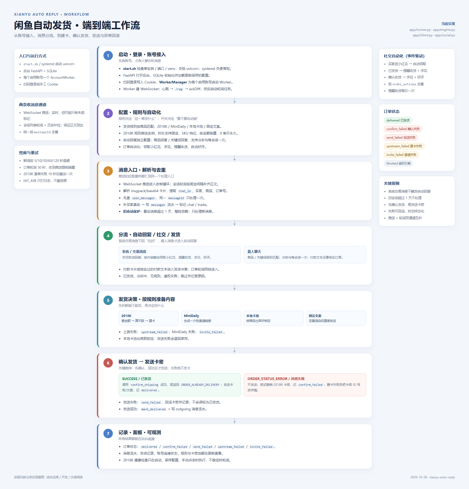
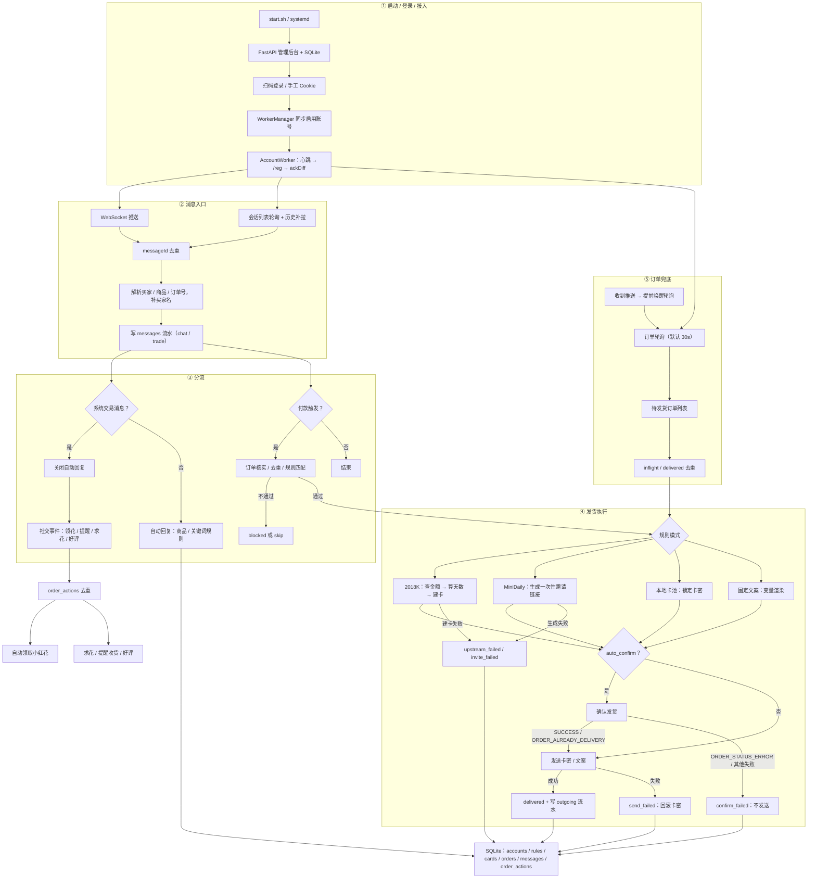
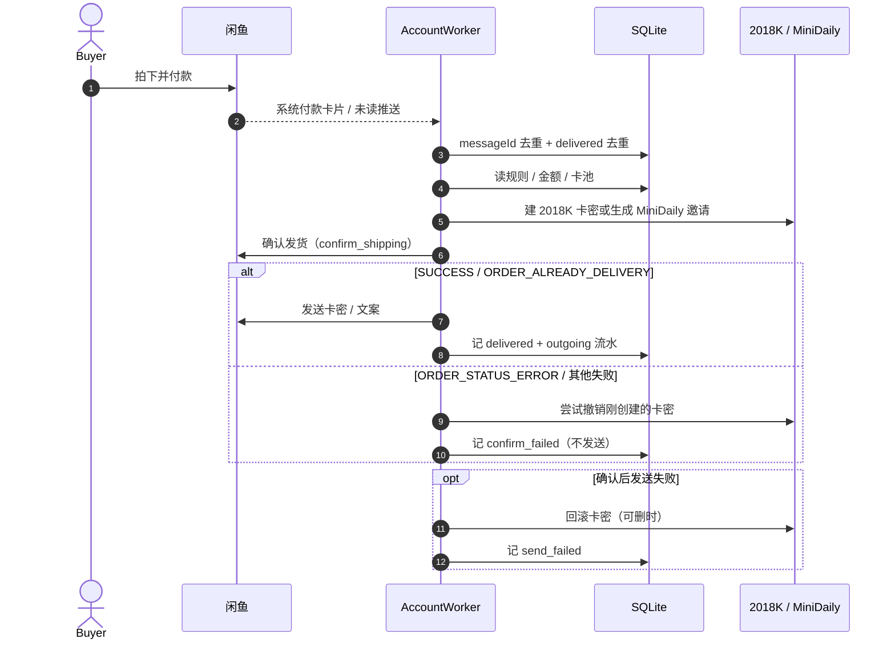

# 闲鱼自动发货 · 端到端工作流

> 依据当前仓库实现整理：`app/runner.py`、`app/engine.py`、`app/client.py`、`app/social.py`、`app/web.py`。  
> 配图：

## 1. 总览图

## 2. 发货关键时序

## 3. 各环节说明

| 环节 | 入口 / 实现 | 关键动作 |
| --- | --- | --- |
| 启动 | `start.sh`、`main.py`、`app/web.py` | 单实例检查、FastAPI、SQLite、加载面板配置 |
| 账号接入 | `app/runner.py` 的 `AccountWorker._once()` | 扫码 Cookie、WebSocket、心跳、`/reg`、ackDiff |
| 规则配置 | `app/engine.py`、后台规则页 | 商品匹配、实例绑定、固定天数 / SKU / 按金额、四种发货模式 |
| 消息接入 | `_process_incoming()` | 推送 + 轮询双通道、`messageId` 去重、旧会话保护、买家名回填、流水 |
| 自动回复 | `app/autoreply.py`、`_maybe_auto_reply()` | 商品 / 关键词匹配；系统交易消息强制跳过；冷却与会话去重 |
| 发货决策 | `DeliveryEngine.decide()` / `decide_order()` | 付款触发、订单核实、`delivered` 去重、规则匹配、卡密出库 |
| 发货执行 | `_deliver_once_inner()` | 建卡 / 邀请 / 卡池 / 文案；**先确认发货，成功后才发送** |
| 异常回滚 | 同上 | `confirm_failed` 不发卡；`send_failed` 回滚；`upstream_failed` / `invite_failed` 明确终态 |
| 订单兜底 | `_order_poll_loop()` | 默认 30 秒拉待发货；推送唤醒；多单并发；已发货去重 |
| 社交自动化 | `app/social.py`、`_handle_social_event()` | 送花自动领取；发货提醒/求花；确认收货求花/好评；按订单去重 |
| 面板与数据 | `app/web.py`、`app/db.py` | 规则、订单、消息、账号、2018K 配置、健康检查 |

## 4. 订单状态

| 状态 | 含义 |
| --- | --- |
| `delivered` | 卡密/文案已成功发送 |
| `confirm_failed` | 确认发货失败，**未发送卡密**；2018K 卡密尝试撤销 |
| `send_failed` | 确认后发送失败；卡密回滚或保留卡密 ID 供人工处理 |
| `upstream_failed` | 2018K 建卡或金额/实例校验失败 |
| `invite_failed` | MiniDaily 邀请生成失败 |
| `blocked` | 真人文本疑似触发发货但订单核实未通过 |

## 5. 需要知道的边界

- 系统交易消息（收货、评价、付款卡片等）**不会触发自动回复**。
- 自动发货必须可核实：系统卡片直接信任；真人文本要查订单状态与买家归属。
- 订单轮询和 WebSocket 共用 `delivered` / `messageId` 去重，不会重复发货或重复处理。
- **旧会话保护**：会话最后一条消息距当前超过 `XY_MESSAGE_STALE_SECONDS`（默认 1 天）时，整段历史都不处理；即使后来会话重新活跃，也只处理新消息，历史消息按同一时间窗口过滤。
- 社交自动化只由交易消息事件触发，不做订单轮询；提醒收货按自然日去重。
- 2018K 健康检查只在启动、保存配置或手动点击时执行，不做定时轮询。
